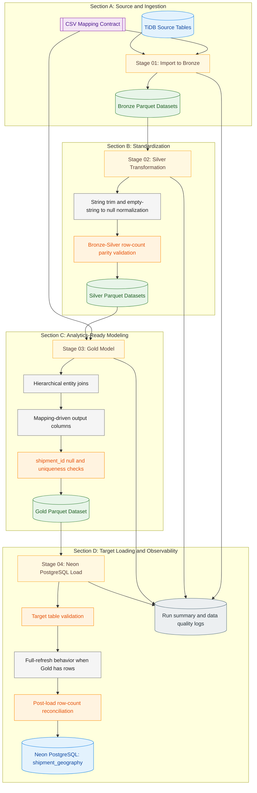

# Shipment Geography Medallion ETL Pipeline

**A mapping-driven Python ETL pipeline that transforms normalized shipment entities from TiDB into an analytics-ready `shipment_geography` table in Neon PostgreSQL.**

[](https://www.python.org/)
[](https://pandas.pydata.org/)
[](https://docs.sqlalchemy.org/)
[](#architecture-and-data-flow)
[](Shipment_Geography_ETL_Pipeline/logs/sg_20261001T070715Z_56edddc9_run_summary.json)

> This project converts normalized operational shipment entities into a denormalized, analytics-ready geography dataset through a four-stage Bronze-Silver-Gold ETL workflow followed by a Neon PostgreSQL load stage.

## At a Glance

| Attribute | Information |
|---|---|
| Business purpose | Shipment geography enrichment |
| Source database | TiDB |
| Target database | Neon PostgreSQL |
| Target table | `shipment_geography` |
| Processing architecture | Bronze-Silver-Gold |
| ETL implementation | Python scripts |
| Source mapping | CSV-based mapping contract |
| Quality controls | Extraction, row-count, schema, and key-integrity checks |
| Recorded execution | 100,000 rows loaded in one verified run |
| Orchestration | Python pipeline runner |

## Table of Contents

1. [Overview](#overview)
2. [Verified Execution Results](#verified-execution-results)
3. [Architecture and Data Flow](#architecture-and-data-flow)
4. [Pipeline Stages](#pipeline-stages)
5. [Data Model](#data-model)
6. [Data Quality and Reliability](#data-quality-and-reliability)
7. [Technology Stack](#technology-stack)
8. [Project Structure](#project-structure)
9. [Setup and Execution](#setup-and-execution)
10. [Current Gaps and Next Improvements](#current-gaps-and-next-improvements)
11. [License](#license)

## Overview

The pipeline extracts source entities from TiDB, standardizes data in layered Parquet datasets, builds a mapping-driven gold dataset, and loads the final output into Neon PostgreSQL.

Source-to-target mapping is centralized in [mappings/shipment_geography_mapping.csv](mappings/shipment_geography_mapping.csv), and execution is orchestrated by [Shipment_Geography_ETL_Pipeline/scripts/run_pipeline.py](Shipment_Geography_ETL_Pipeline/scripts/run_pipeline.py).

## Verified Execution Results

Recorded run ID: `sg_20261001T070715Z_56edddc9`

| Metric | Value |
|---|---:|
| Pipeline status | success |
| Total stages | 4 |
| Checks passed | 24 |
| Checks failed | 0 |
| Gold rows built | 100,000 |
| Rows loaded to Neon | 100,000 |

### Stage Durations

| Stage | Duration |
|---|---:|
| `01_import_to_bronze` | 5.946 seconds |
| `02_silver` | 0.841 seconds |
| `03_gold` | 0.551 seconds |
| `04_load_neon` | 99.396 seconds |
| **Total (sum of recorded stage durations)** | **106.734 seconds** |

These figures represent one recorded execution and should not be treated as a performance benchmark or SLA.

Evidence:
- [Shipment_Geography_ETL_Pipeline/logs/sg_20261001T070715Z_56edddc9_run_summary.json](Shipment_Geography_ETL_Pipeline/logs/sg_20261001T070715Z_56edddc9_run_summary.json)
- [Shipment_Geography_ETL_Pipeline/logs/sg_20261001T070715Z_56edddc9_data_quality_checks.jsonl](Shipment_Geography_ETL_Pipeline/logs/sg_20261001T070715Z_56edddc9_data_quality_checks.jsonl)

## Architecture and Data Flow



Flow summary: TiDB -> Bronze -> Silver -> Gold -> Neon PostgreSQL.

Legend:
- Blue nodes: databases.
- Green nodes: Parquet data layers.
- Yellow nodes: stage boundaries.
- Purple node: mapping configuration.
- Gray and orange nodes: processing logic and quality controls.
- Slate node: observability outputs.

## Pipeline Stages

### Stage 01 - Import to Bronze

- Script: [Shipment_Geography_ETL_Pipeline/scripts/01_import_to_bronze.py](Shipment_Geography_ETL_Pipeline/scripts/01_import_to_bronze.py)
- Input: mapped source table names from [mappings/shipment_geography_mapping.csv](mappings/shipment_geography_mapping.csv), TiDB source tables.
- Processing logic: reads each mapped source table from TiDB and writes one Parquet file per table to Bronze.
- Output: `Shipment_Geography_ETL_Pipeline/parquet/bronze/*.parquet`.
- Quality checks: source table contract presence and per-table extraction checks.

### Stage 02 - Silver Transformation

- Script: [Shipment_Geography_ETL_Pipeline/scripts/02_silver.py](Shipment_Geography_ETL_Pipeline/scripts/02_silver.py)
- Input: Bronze Parquet datasets.
- Processing logic: trims string values and converts empty strings to nulls.
- Output: `Shipment_Geography_ETL_Pipeline/parquet/silver/*.parquet`.
- Quality checks: table-level Bronze-to-Silver row-count parity checks.

### Stage 03 - Gold Modeling

- Script: [Shipment_Geography_ETL_Pipeline/scripts/03_gold.py](Shipment_Geography_ETL_Pipeline/scripts/03_gold.py)
- Input: Silver datasets plus mapping contract.
- Processing logic: performs hierarchical joins and aligns output columns to mapping target columns.
- Output: `Shipment_Geography_ETL_Pipeline/parquet/gold/shipment_geography.parquet`.
- Quality checks: mapped column presence, `shipment_id` null check, `shipment_id` uniqueness check.

### Stage 04 - Neon PostgreSQL Load

- Script: [Shipment_Geography_ETL_Pipeline/scripts/04_load_neon.py](Shipment_Geography_ETL_Pipeline/scripts/04_load_neon.py)
- Input: Gold Parquet dataset.
- Processing logic: validates target table, then for non-empty Gold data truncates target and appends data.
- Output: loaded rows in target table `shipment_geography` in Neon PostgreSQL.
- Quality checks: target table existence and post-load row-count reconciliation.

Load behavior note:
- The current implementation is full-refresh for non-empty Gold output (truncate then append).
- If the load is interrupted after truncation, downstream consumers can be affected until recovery is completed.
- The code uses a transactional connection for load operations, but this README does not claim SLA-level rollback or recovery guarantees.

### Orchestration

- Script: [Shipment_Geography_ETL_Pipeline/scripts/run_pipeline.py](Shipment_Geography_ETL_Pipeline/scripts/run_pipeline.py)
- Verified options: `--from-stage` and `--to-stage` with supported values 01 through 04.
- Behavior: executes selected stages sequentially and builds run summary from stage metrics.

## Data Model

Target table: `shipment_geography`

| Column | Purpose |
|---|---|
| `shipment_id` | Shipment identifier |
| `customer_name` | Associated customer |
| `office_name` | Associated office |
| `pincode` | Postal or PIN code |
| `city_name` | City |
| `zone_name` | Zone |
| `state_name` | State |
| `region_name` | Region |
| `country_name` | Country |

Join chain:

```text
shipment -> customer -> office -> pin_code -> city -> zone/state -> region -> country
```

Mapping reference: [mappings/shipment_geography_mapping.csv](mappings/shipment_geography_mapping.csv)

The mapping contract centralizes source-to-target column relationships used by Bronze extraction and Gold output alignment.

## Data Quality and Reliability

### Data Quality Controls

| Check | Pipeline Stage | Purpose |
|---|---|---|
| Source table contract | Bronze | Verify required mapped sources |
| Extraction validation | Bronze | Detect extraction problems |
| Row-count parity | Silver | Detect unexpected count differences |
| Gold output columns | Gold | Verify mapped schema presence |
| `shipment_id` null check | Gold | Prevent missing shipment identifiers |
| `shipment_id` uniqueness | Gold | Detect duplicate shipment identifiers |
| Target table existence | Load | Verify destination availability |
| Post-load reconciliation | Load | Compare expected and actual row counts |

### Operational Reliability

- Database retry behavior is implemented via `run_with_retries` in [Shipment_Geography_ETL_Pipeline/scripts/sg_common.py](Shipment_Geography_ETL_Pipeline/scripts/sg_common.py).
- Strict-mode behavior is configurable via `SG_STRICT_MODE` and affects failure handling in validation checks.
- Run-specific observability is captured in stage metrics, data-quality checks, and run-summary artifacts.
- Row-count reconciliation is implemented after loading to target.
- Load strategy is full refresh for non-empty Gold data (truncate then append), as implemented in Stage 04.

## Technology Stack

| Category | Technology | Purpose |
|---|---|---|
| Language | Python | ETL scripts and orchestration |
| Data processing | Pandas | Data manipulation and transformation |
| Database abstraction | SQLAlchemy | Database connectivity abstraction |
| Source driver | PyMySQL | TiDB connectivity |
| Target driver | psycopg2 | PostgreSQL connectivity |
| Intermediate storage | Parquet / PyArrow | Layered datasets |
| Configuration | python-dotenv | Environment variable loading |
| Mapping | CSV | Source-to-target contract |

Dependencies: [requirements.txt](requirements.txt)

## Project Structure

```text
L&T_ETL_Project/
├── README.md
├── requirements.txt
├── mappings/
│   └── shipment_geography_mapping.csv
└── Shipment_Geography_ETL_Pipeline/
  ├── logs/
  ├── parquet/
  │   ├── bronze/
  │   ├── silver/
  │   └── gold/
  └── scripts/
    ├── sg_common.py
    ├── 01_import_to_bronze.py
    ├── 02_silver.py
    ├── 03_gold.py
    ├── 04_load_neon.py
    └── run_pipeline.py
```

## Setup and Execution

### 1. Prerequisites

- Windows PowerShell workflow with an existing virtual environment at `myenv`.
- TiDB source access and Neon PostgreSQL target access.
- Root `.env` file configured with connection and pipeline settings.

### 2. Environment Configuration

Verified environment keys from implementation (placeholders only):

- TiDB: `TIDB_HOST`, `TIDB_PORT`, `TIDB_USER` (or `TIDB_USERNAME`), `TIDB_PASSWORD`, `TIDB_DATABASE`
- Neon: `NEON_DSN` or `NEON_HOST`, `NEON_PORT`, `NEON_DB`, `NEON_USER`, `NEON_PASSWORD`
- Target schema: `TARGET_SCHEMA`
- Pipeline options: `SG_MAPPING_FILE`, `SG_BRONZE_LAYER_SUBDIR`, `SG_SILVER_LAYER_SUBDIR`, `SG_GOLD_LAYER_SUBDIR`, `SG_LOG_SUBDIR`, `SG_BATCH_SIZE` (or `BATCH_SIZE`), `SG_STRICT_MODE`, `SG_MAX_DB_RETRIES`, `SG_RETRY_BACKOFF_SECONDS`

Never commit secrets or share `.env` contents.

### 3. Dependency Installation

```powershell
.\myenv\Scripts\python.exe -m pip install -r .\requirements.txt
```

For new environments, create and activate a virtual environment first, then install requirements.

### 4. Run Full Pipeline

```powershell
.\myenv\Scripts\python.exe .\Shipment_Geography_ETL_Pipeline\scripts\run_pipeline.py
```

### 5. Run Partial Pipeline

```powershell
.\myenv\Scripts\python.exe .\Shipment_Geography_ETL_Pipeline\scripts\run_pipeline.py --from-stage 02 --to-stage 04
```

Partial run implications:
- Upstream datasets must already exist for selected stages.
- Example: starting at Stage 02 requires Bronze Parquet artifacts to be present.
- Example: starting at Stage 04 requires Gold output to be present.

### 6. Safety Requirements

- Do not include real credentials in repository files.
- Do not expose `.env` values.
- Be aware that Stage 04 may replace target data when Gold data is non-empty (full refresh behavior).
- Do not run destructive operations against production targets without change control.

## Current Gaps and Next Improvements

| Area | Current Status | Recommended Improvement |
|---|---|---|
| Schema and join validation | Manual validation through code checks and run logs | Add automated schema and join validation tests (highest priority) |
| Target-load safety and recovery | Full-refresh load for non-empty Gold output | Add safer load strategy and explicit failure-recovery workflow |
| Incremental processing | Not implemented | Add incremental or CDC-based loading |
| Scheduling and alerting | Not implemented | Add scheduler integration and failure notifications |
| Monitoring and dashboards | Run logs available, no dashboard layer | Add operational monitoring and dashboarding |
| Automated testing | No test suite present | Add unit and integration tests for stages and contracts |

## License

No LICENSE file is currently present in this repository.
