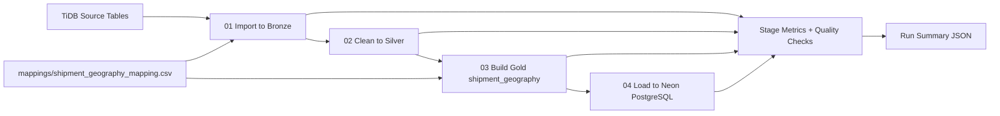

# 📦 Shipment Geography Medallion ETL Pipeline

## 🚀 Project Overview

This project transforms normalized logistics data into an analytics-ready geography dataset using a **Medallion architecture (Bronze, Silver, Gold)** and Python-based ETL orchestration.

The primary outcome is a curated target table: **`shipment_geography`**, loaded into Neon PostgreSQL for downstream reporting and BI analysis.

---

## 🧱 Data Model & Architecture

The pipeline models shipment location hierarchy into one consumer-friendly output table:

- **Target Table:** `shipment_geography`
- **Primary Business Key:** `shipment_id`
- **Geography Attributes:** customer, office, pincode, city, zone, state, region, country

Lookup path used in transformations:

`shipment -> office -> pin_code -> city -> zone/state -> region -> country`

Architecture flow:



---

## 🔄 ETL Process

Implemented as a four-stage pipeline plus orchestrator:

1. **Extract to Bronze** (`01_import_to_bronze.py`)
  - Reads mapped source tables from TiDB
  - Writes table-level Parquet files to Bronze layer
2. **Transform to Silver** (`02_silver.py`)
  - Trims text fields and normalizes empty strings to null
  - Preserves row counts between Bronze and Silver
3. **Model Gold Dataset** (`03_gold.py`)
  - Performs hierarchical joins across source entities
  - Builds final `shipment_geography.parquet` with mapped target columns
4. **Load to Neon** (`04_load_neon.py`)
  - Validates target table existence
  - Truncates and fully reloads data (full refresh)
  - Verifies post-load row counts

Pipeline runner:

- **`run_pipeline.py`** supports full run and stage-range execution (`--from-stage`, `--to-stage`)

---

## ✅ Data Quality & Reliability

Quality gates implemented across stages:

- Source table contract presence from mapping
- Table-level extraction checks
- Bronze vs Silver row-count parity
- Gold mapped-column contract validation
- `shipment_id` null check
- `shipment_id` duplicate check
- Neon target table existence check
- Post-load count validation

Reliability controls:

- Retry logic for transient DB read/write failures
- Strict-mode enforcement (`SG_STRICT_MODE`)
- Run ID based tracing across all metrics and checks

---

## 📈 Monitoring Outputs

For each pipeline run (`run_id`), logs are generated in `Shipment_Geography_ETL_Pipeline/logs`:

- `{run_id}_stage_metrics.jsonl`
- `{run_id}_data_quality_checks.jsonl`
- `{run_id}_run_summary.json`

These artifacts provide auditable execution history and can be integrated with dashboards or alerting workflows.

---

## 📊 Validated Run Snapshot

Reference summary:

- `Shipment_Geography_ETL_Pipeline/logs/sg_20261001T070715Z_56edddc9_run_summary.json`

Key observed results:

- Run status: `success`
- Total stages: `4`
- Checks passed: `24`
- Checks failed: `0`
- Gold rows built: `100000`
- Rows loaded to Neon: `100000`

---

## 🛠️ Tech Stack

- **Language:** Python
- **Data Processing:** Pandas
- **Database Connectivity:** SQLAlchemy
- **Source Driver:** PyMySQL (TiDB/MySQL protocol)
- **Target Driver:** psycopg2 (Neon PostgreSQL)
- **Storage Format:** Parquet (PyArrow)
- **Config Management:** python-dotenv

---

## 📂 Project Structure

```text
L&T_ETL_Project/
|- README.md
|- INTERVIEW_STAR_STORY.md
|- requirements.txt
|- .env
|- mappings/
|  |- shipment_geography_mapping.csv
|- Shipment_Geography_ETL_Pipeline/
|  |- README.md
|  |- parquet/
|  |  |- bronze/
|  |  |- silver/
|  |  |- gold/
|  |- logs/
|  |- scripts/
|     |- sg_common.py
|     |- 01_import_to_bronze.py
|     |- 02_silver.py
|     |- 03_gold.py
|     |- 04_load_neon.py
|     |- run_pipeline.py
```

---

## ▶️ Quick Start

1. Install dependencies:

```powershell
.\myenv\Scripts\python.exe -m pip install -r .\requirements.txt
```

2. Run full pipeline:

```powershell
.\myenv\Scripts\python.exe .\Shipment_Geography_ETL_Pipeline\scripts\run_pipeline.py
```

3. Run partial pipeline (example: silver to load):

```powershell
.\myenv\Scripts\python.exe .\Shipment_Geography_ETL_Pipeline\scripts\run_pipeline.py --from-stage 02 --to-stage 04
```

---

## 💡 Key Learnings

- Built an end-to-end Medallion ETL with production-style operational controls
- Converted normalized OLTP-style source tables into analytics-ready output
- Implemented contract-driven transformation using a mapping CSV
- Added observability and data quality checks for trustworthy loads

---

## 🔮 Future Improvements

- Add incremental/CDC loading to reduce full-refresh dependency
- Add scheduling and alerting integration
- Add automated tests for schema contracts and join assumptions
- Add BI dashboard templates on top of `shipment_geography`
